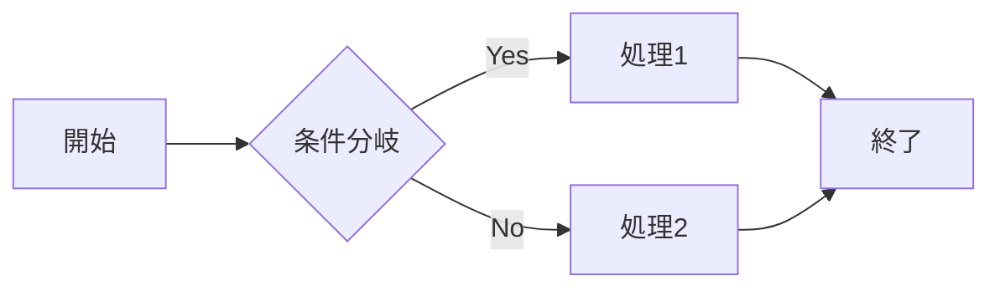
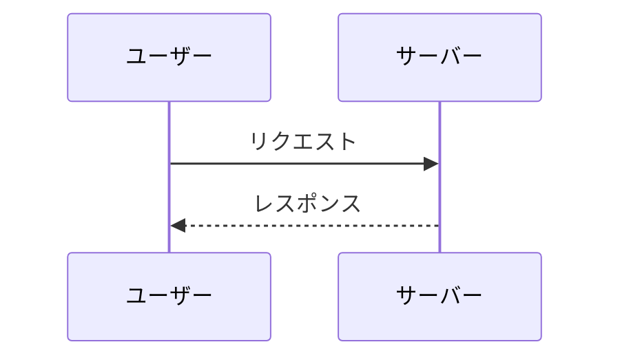

# タイトル

これはサンプルです。

## 機能

- **太字**や*斜体*のテキスト
- `インラインコード`
- リンク: [GitHub](https://github.com)

### リスト

1. 番号付きリスト
2. 2つ目の項目
3. 3つ目の項目

- 箇条書き
  - もう一つの項目

### 引用

> これは引用です。
> GitHubのプレビューと同じスタイルになっています。

### テーブル

| 左寄せ | 中央 | 右寄せ |
| :------- | :-------: | -------: |
| 1   | 2   | 3 |
| A   | B   | C |

### チェックボックス

- [x] チェックボックス
- [ ] 未チェックボックス

### サマリー

<details>
<summary>ココをクリック</summary>
詳細テキスト
</details>

### ライン

---

### アラート

> [!NOTE]
> ユーザーがコンテンツを読み飛ばしている場合でも知っておくべき有用な情報。

> [!TIP]
> 物事をより良く、またはより簡単に行うための役立つアドバイス。

> [!IMPORTANT]
> ユーザーが目標を達成するために知っておく必要がある重要な情報。

> [!WARNING]
> 問題を回避するために、ユーザーの即座の注意が必要な緊急情報。

> [!CAUTION]
> 特定のアクションのリスクまたはマイナスの結果についての警告。

> [!NOTE]
> アラート内でも `インラインコード` やコードブロックが正しく表示されます。
>
> ```javascript
> console.log("alert 内のコードブロック");
> ```

### コードブロック

```javascript
function hello() {
    console.log("Hello, World!");
}
```

```python
def greet(name):
    return f"Hello, {name}!"

print(greet("World"))
```

### 図（Mermaid）





### フットノート

これは脚注付きの文章です[^1]

[^1]: これが脚注の内容です。

